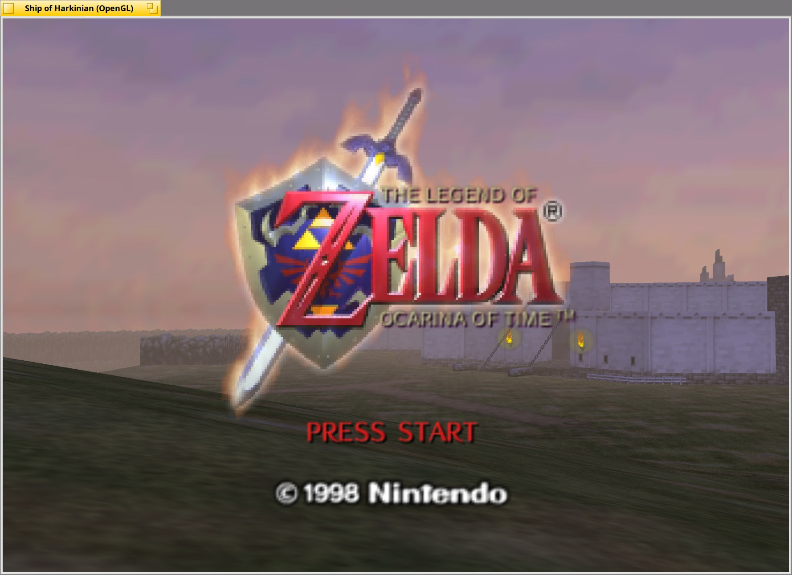

# Ship of Harkinian for Haiku

An unofficial port of [Ship of Harkinian](https://github.com/HarbourMasters/Shipwright), the PC port of
*The Legend of Zelda: Ocarina of Time*, to [Haiku](https://www.haiku-os.org/).



> [!IMPORTANT]
> This fork is not affiliated with HarbourMasters or Nintendo. Report Haiku-specific problems in this repository's
> [Issues](https://github.com/Techniix/Shipwright_HaikuOS/issues), not to the upstream project. Licensing details are
> in [NOTICE.md](NOTICE.md).

## Status

Ship of Harkinian builds and runs natively on Haiku x86_64: OpenGL rendering through Haiku's GL stack, SDL2 audio and
input, and a native Tracker file panel for picking your ROM.

Ship of Harkinian has no published license, so this fork does not distribute prebuilt packages. You build it yourself
from source (one script, below).

## What you need

- Haiku R1/beta5 or a recent nightly, **x86_64**
- About 4 GB of free disk space and an internet connection for the first build
- A **legally obtained** Ocarina of Time ROM. The port contains no game assets; they are extracted from your ROM on your
  machine. Check that your ROM is supported at [ship.equipment](https://ship.equipment/), or compare its SHA-1 with
  [docs/supportedHashes.json](docs/supportedHashes.json).

## Build

In Terminal:

```sh
git clone --recursive https://github.com/Techniix/Shipwright_HaikuOS.git
cd Shipwright_HaikuOS
scripts/haiku/build.sh --deps
```

`--deps` installs the build dependencies with `pkgman` the first time; leave it off for later builds. The build takes a
while (an hour or more in a VM). To update later:

```sh
git pull
scripts/haiku/build.sh
```

If the build fails, save the output and open an issue with it:

```sh
scripts/haiku/build.sh 2>&1 | tee ~/soh-build.log
```

More detail, including building by hand, is in [docs/HAIKU.md](docs/HAIKU.md).

## Play

1. Start `build-haiku/soh/soh` from Terminal, or double-click `soh` in Tracker.
2. On first launch, pick your ROM in the file panel (or put the `.z64`/`.n64`/`.v64` file next to `soh` beforehand).
   The game builds `oot.o2r` from it, which takes a few minutes, then starts.

Saves, settings, mods and the generated `.o2r` files live in the same folder as `soh`. Set `SHIP_HOME` to keep them
elsewhere.

### Performance

Rendering goes through Haiku's OpenGL, so speed depends on your driver:

- With the default software renderer, everything runs on the CPU. Lower **Internal Resolution** and leave MSAA off in
  the Settings menu if it's slow.
- With hardware-accelerated drivers (for example the experimental NVK + Zink stack for NVIDIA), the game uses them
  automatically.

## Controls

| N64 | A | B | Z | Start | Analog stick | C buttons | D-Pad |
| - | - | - | - | - | - | - | - |
| Keyboard | X | C | Z | Space | WASD | Arrow keys | TFGH |

| Keys | Action |
| - | - |
| Esc | Toggle menu |
| F2 | Toggle mouse capture |
| F5 / F6 / F7 | Save state / change slot / load state |
| F11 | Fullscreen |
| Tab | Toggle alternate assets |
| Ctrl+R | Reset |

Controllers work through SDL's Haiku joystick support and can be remapped in the menu.

## Haiku-specific notes

- Menus always draw inside the game window. Pop-out menu windows are off by default on Haiku; set
  `SHIP_HAIKU_VIEWPORTS=1` to try them.
- Text to speech (F9) is only available if `espeak-ng` was installed when you built.
- Crashes open Haiku's debugger rather than Ship of Harkinian's crash report.

## Mods and custom assets

Put `.o2r`/`.otr` mod archives in the `mods` folder next to `soh`. See [docs/MODDING.md](docs/MODDING.md) and
[docs/CUSTOM_MUSIC.md](docs/CUSTOM_MUSIC.md). Tools for making assets:
[retro](https://github.com/HarbourMasters64/retro) and [fast64](https://github.com/HarbourMasters/fast64).

## How the port works

Ship of Harkinian runs on [libultraship](https://github.com/Kenix3/libultraship), which stands in for the N64's
libultra SDK, and on the code from the [OoT decompilation](https://github.com/zeldaret/oot). The Haiku support is:

- **libultraship:** a patch in `scripts/haiku/patches/`, applied automatically when you configure on Haiku, so the
  submodule stays on its upstream commit.
- **Ship of Harkinian:** changes in this repository guarded by `__HAIKU__` or CMake `Haiku` checks, plus
  `soh/soh/platform/haiku/` (file panel) and `soh/haiku/` (app resources).

This fork follows upstream `develop`. Other platforms build exactly as upstream; for Windows, macOS and Linux, use
[the official releases](https://github.com/HarbourMasters/Shipwright/releases).

## Credits

All credit for Ship of Harkinian goes to [HarbourMasters](https://github.com/HarbourMasters) and its contributors
([docs/CREDITS.md](docs/CREDITS.md)), and to the OoT decompilation team. Haiku port by Techniix.

<a href="https://github.com/Kenix3/libultraship/">
  <picture>
    <source media="(prefers-color-scheme: dark)" srcset="./docs/poweredbylus.darkmode.png">
    
  </picture>
</a>
